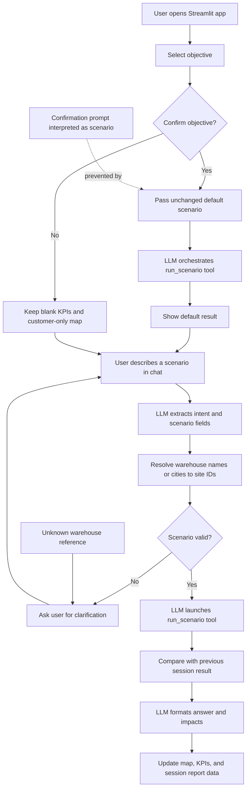

# Agent Failure Cases and Fixes

This document records the agent failures found during testing of the Green Warehouse Network Streamlit application.

## 1. Objective confirmation invented a warehouse closure

### Symptom

After selecting an objective such as CO₂ and clicking **Confirm objective**, the assistant returned a warehouse-assignment change involving a warehouse closure even though the user had not entered a scenario.

### Root cause

The confirmation button sent a natural-language prompt through the same LLM intent parser used for user scenario requests. The parser was allowed to interpret the prompt as a scenario and could invent fields such as `close_sites`.

### Fix

Objective confirmation now uses an explicit control path:

- It passes the unchanged default scenario to the graph.
- The intent parser is bypassed for this control action.
- The LLM still orchestrates and launches the `run_scenario` tool.
- The LLM cannot invent warehouse closures or other scenario changes during confirmation.
- Scenario changes can only come from a subsequent user chat message.

### Regression coverage

`test_objective_confirmation_runs_default_without_inventing_changes` verifies that confirmation does not call the intent parser and sends an empty `close_sites` list to the solver.

## 2. City name was rejected as an unknown warehouse

### Symptom

The user entered:

> What if we close Hamburg site?

The agent returned:

> unknown site: Hamburg

### Root cause

The scenario schema expects candidate warehouse IDs such as `W01`, while the intent parser returned the city name `Hamburg`. Validation compared the city name directly with the warehouse IDs and rejected it.

### Fix

The intent parser now receives the candidate warehouse catalog, including IDs and names. A generic resolver converts recognized warehouse names and cities to their IDs before validation.

For example:

| User reference | Resolved site ID |
|---|---|
| Hamburg | `W01` |
| Hamburg site | `W01` |
| Hamburg logistics hub | `W01` |

Unknown names are still left unchanged so the normal validation and clarification flow can handle them safely.

### Regression coverage

`test_city_name_resolves_to_candidate_site_id` verifies that a Hamburg closure is passed to the solver as `close_sites: ["W01"]`.

## 3. Hypothetical electric-truck request ran without a change

### Symptom

The user entered:

> what happen if we change trucks to electric?

The app ran the current CO2 plan again. A more direct request such as:

> change to electric trucks

worked.

### Root cause

Both requests reached the LLM parser, but the shorter hypothetical wording could return an empty structured scenario. The graph then merged the empty result with the current scenario and ran `run_scenario` anyway. The reply could fall through to the fixed safety template, making the failure look like a valid unchanged result.

### Fix

- The intent prompt now includes schema descriptions and eight few-shot examples.
- Hypothetical requests containing a concrete change, including “what happens if”, are explicitly classified as `scenario`.
- The parser is now LLM-only for request understanding. The old `_requested_site_change` and `_explicit_scale_change` regex parsers were removed.
- If no fields are extracted, the graph does not call `run_scenario` and replies: `I didn't find anything to change. I can change ...`.
- If all requested values already equal the current scenario, it replies: `Already <value>, nothing changes.`

### Regression coverage

`test_empty_scenario_does_not_run_solver`, `test_value_equal_to_current_does_not_run_solver`, and `test_structured_parser_does_not_have_a_keyword_fallback` cover the no-op and no-regex behavior.

## 4. OpenAI failures were not explicit enough

### Symptom

Missing credentials or a failed OpenAI request could surface as a generic agent failure, and the system had a direct solver fallback for test-like models without tool support.

### Fix

- Missing `OPENAI_API_KEY` raises a clear configuration error in chat.
- Intent parsing, tool orchestration, response generation, and report generation errors are reported as OpenAI errors.
- No parser or solver fallback is used after an OpenAI failure.

### Regression coverage

`test_openai_parse_failure_is_returned_as_a_clear_chat_error` verifies the user-facing error path.

## 5. Zero-impact replies used misleading numbers

### Symptom

An unchanged run produced text such as:

> Compared with the previous plan, the change is 0.0 € and 0.0 t CO2.

Replies also exposed decimal money values even when whole euros were more appropriate.

### Fix

- Zero cost and CO2 deltas now say: `No change since the previous run.`
- Money amounts in agent replies are rounded to whole euros.
- The number validation allows whole-euro rounding without treating it as a hallucinated value.

## 6. Runtime OpenRouteService request caused a 403 warning

### Symptom

The dashboard showed a blue warning after a solver run:

> OpenRouteService request failed with HTTP 403: [response message]. Haversine distance × 1.3 was used instead.

### Root cause

When the cached distance matrix was missing, `src/geo.py` used `OpenRoute_API_KEY` to make a live OpenRouteService Matrix API request. This happened during validation and scenario preparation, before the CBC solver ran.

### Fix

The runtime ORS request was removed. The app now reads prepared cached distances and otherwise uses the local haversine × 1.3 estimate. The complete current provenance message is:

> No cached OpenRouteService distance matrix is available; the solver does not call OpenRouteService at runtime. Haversine distance × 1.3 was used instead.

The dashboard now renders structured warning details as the full message instead of exposing a list representation.

## 7. Natural-language paraphrase coverage

### Regression coverage

`tests/test_openai_paraphrases.py` contains 15 opt-in live cases:

- 4 electric-truck paraphrases
- 3 demand increase paraphrases
- 3 Hamburg closure paraphrases
- 3 backup-distance paraphrases
- 2 cost-objective paraphrases

The live OpenAI run parsed **15/15** correctly. The test runs only when `OPENAI_API_KEY` is configured.

## Validation status

The deterministic suite passes with 27 tests. The opt-in live paraphrase suite passes with 15/15 cases.

## 8. Confirming the planning objective modified a widget-owned state key

### Symptom

Clicking **Confirm objective** could show:

> `st.session_state['objective_selection']` cannot be modified after the widget with that key is instantiated.

### Root cause

The sidebar selectbox owns the `objective_selection` session-state key. After the selectbox was created, the agent response handler wrote the parsed objective back to that same key during the button action.

### Fix

The selectbox value is now treated as user-controlled widget state. The confirmed value is stored separately in `confirmed_objective`, and the response handler no longer writes to `objective_selection` after widget creation.

`python3 -m py_compile app.py` and `git diff --check` pass after the fix.
